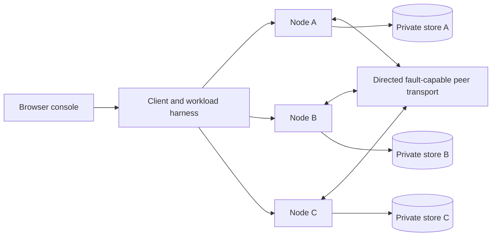

# QuorumSpindle

Replicated state and consensus. Run three real local servers that agree on single-key state despite crashes, partitions and delayed messages. Make every acknowledged command explainable through durable votes, replicated log history and applied results.

**Stage:** requirements and design baseline, 25 November 2026. Runtime implementation and acceptance have not started.

Each Raft node owns a private durable store. A majority is two of three, not a shared database transaction or a decision by the harness. New commands, including reads, require committed and durably applied log entries.

Start with the [documentation guide](docs/README.md), [product requirements](docs/requirements/product.md), [high-level architecture](docs/architecture/high-level-design.md) and [component designs](docs/design/README.md).

[JSON Schemas](schemas/README.md), [worked examples](examples/README.md) and [reference SQL](schemas/reference-schema.sql) make the contracts concrete. They are design artifacts, not a running engine.

Reference direction: Python services, SQLite as a local durability primitive, semantic HTML/CSS/JavaScript and ordinary loopback processes. Exact dependency versions and performance remain subject to environment verification and measured evidence. Existing consensus/indexing/stream-processing frameworks cannot replace the core protocol.

Public repository; [MIT license](LICENSE). The [original requirements](docs/source/README.md) remain archived. This is AI-assisted documentation, not an unaided personal submission.
