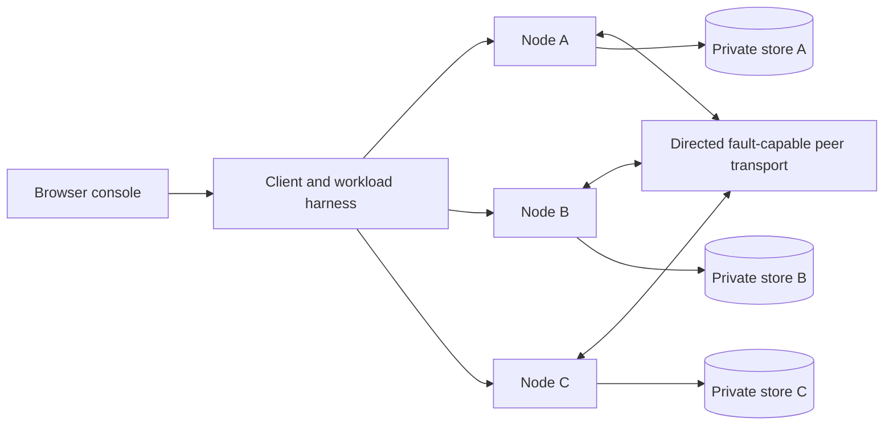
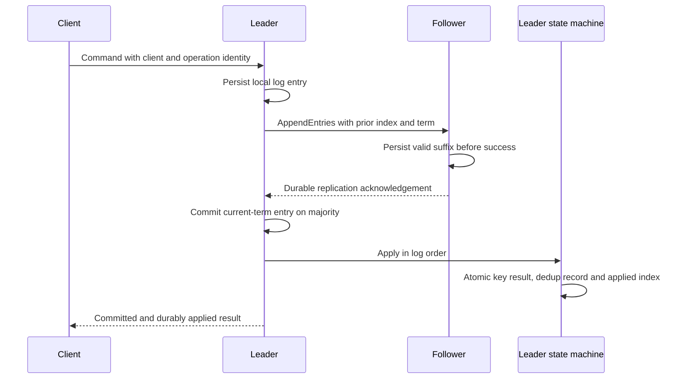

# High-level design

Run three real local servers that agree on single-key state despite crashes, partitions and delayed messages. Make every acknowledged command explainable through durable votes, replicated log history and applied results.

## Process topology

Each Raft node owns a private durable store. A majority is two of three, not a shared database transaction or a decision by the harness. New commands, including reads, require committed and durably applied log entries.

Every process is local, assets are bundled, and data is generated. The source runtime/dependency limits are preserved. The browser is an inspection/control surface; it is not an authority that makes data safe.

## Main protocol sequence

## Responsibilities

| Component | Responsibility |
| --- | --- |
| [Single-key semantics logged reads and deduplication](../design/state-machine.md) | Validate client/operation identity, key, bounded bytes and expected version. |
| [Durable elections votes and term transitions](../design/elections.md) | Use seeded randomized monotonic elapsed-time election timers. |
| [Log matching conflict repair and majority commitment](../design/replication.md) | Leader persists new local entries before advertising durable replication. |
| [Node durability atomic application and snapshots](../design/storage-snapshots.md) | Persist hard state and log before safety-dependent responses. |
| [Controlled peer transport admission and client uncertainty](../design/transport.md) | Keep client and peer listeners/routes distinct and validate fixed membership. |
| [Independent bounded-history checker and large-run audits](../design/checker.md) | Build a separate reference key/version model and known legal/illegal histories. |

## Workload boundary

Three actual nodes and private stores; 50,000 keys <=1 KiB; >=200 successful operations/s for 60 seconds at 70% writes/CAS and 30% reads, p95 <=2 seconds; 1,000 logical clients with <=256 TCP connections.

A 1,000-contender CAS race repeats 100 times with exactly one winner and completed conflicts within 30 seconds/round. Twenty leader-kill trials must recover a stable majority within five seconds. One hundred seeded fault schedules and a thirty-minute soak retain actual failures and unknown outcomes.

These are required local pass bars, not current measurements. Performance work must preserve durability, independent checks and complete outcome accounting.
