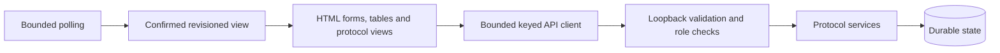

# Browser and control API modules

Plan a local index.html, CSS and small JavaScript modules for API, state, forms and inspection. All assets are bundled. Optional TypeScript compiles locally; the browser needs no runtime compiler. Data tables are bounded and graphs have accessible text/table equivalents.

Mutation keys survive double-click and uncertain responses. Expected state conflicts require refresh and reconsideration, not silent rewrites. Escape all payloads, show loading/empty/error/disconnected states and retain keyboard focus through dialogs. Control polling does not become benchmark traffic.

## Basic browser UI

Provide local HTML, CSS, and JavaScript, with optional locally compiled TypeScript. No CDN, external fonts, analytics, or online login.

Required screens: cluster overview; node/log inspection; key read/CAS playground; directed partition controls; scenario runner; and report viewer. Display terms and indices beside role labels so users can understand delayed information. Separate committed entries from pending entries. Show an unknown client outcome as unknown.

All destructive lab actions identify affected test nodes. Controls need keyboard access, visible error states, disabled/busy behavior, and confirmation for deleting a test dataset. Polling must be bounded and must not become benchmark traffic unless explicitly selected.

The future UI uses actual APIs and reports durable state. This repository delivers its design; it contains no dashboard pretending that runtime acceptance has occurred.
