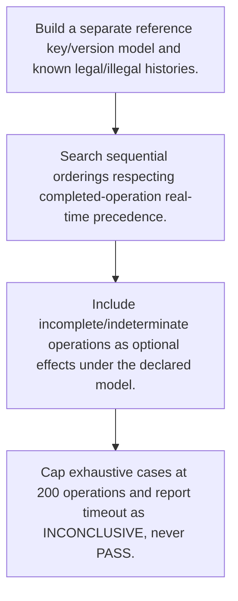

# Independent bounded-history checker and large-run audits

Memoize model/search states and retain a counterexample order on failure. Duplicate request identities share one logical effect and stored response. Large runs use committed-log folds, unique request results and state digests plus sampled bounded histories; they are not described as exhaustively checked.

## Algorithm

1. Build a separate reference key/version model and known legal/illegal histories.
2. Search sequential orderings respecting completed-operation real-time precedence.
3. Include incomplete/indeterminate operations as optional effects under the declared model.
4. Cap exhaustive cases at 200 operations and report timeout as INCONCLUSIVE, never PASS.

## Interface and ownership

The service accepts bounded typed data plus logical target/request identity and the relevant epoch, term, pin or expected revision. It returns a durable result, explicit conflict or uncertainty. See [API](../contracts/api.md), [data model](../contracts/data-model.md) and [transactions](transactions.md). Network/worker acknowledgements mean only the boundary explicitly defined by the protocol.

## Required behavior

## Independent correctness checks

Maintain a simple reference model for the key state and CAS semantics. Build a bounded-history linearizability checker that searches legal sequential orderings while respecting invocation/response precedence. Cap each exhaustive case at 200 operations and declare checker timeouts inconclusive, never passed.

Include incomplete and indeterminate operations as optional effects according to the checker model. Validate the checker using known legal and illegal histories, including a stale read and two successful CAS operations against one version.

For large workloads, validate committed-log/state digests, request uniqueness, and final state against a fold of the committed commands. Check sampled bounded histories separately. These checks complement one another; they do not establish that every large history has been exhaustively linearizability-checked.

## Recovery and verification

Before-commit failure exposes no accepted local change. After-commit response loss is resolved through stable logical identity or persisted operation status. Stale epochs/terms/fences cannot mutate newer progress. The independent oracle must not call the production algorithm it evaluates. Exercise actual stop hooks and inspect committed records through the [harness](../testing/harness-and-fixtures.md); all runtime verdicts remain NOT RUN.
