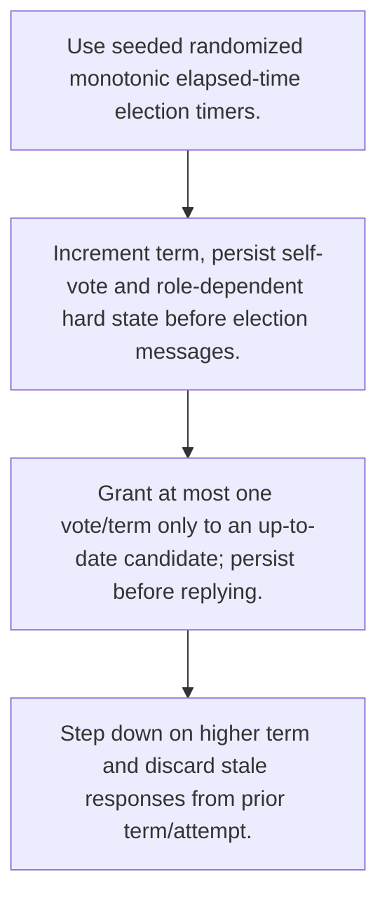

# Durable elections votes and term transitions

Proposed local timing: heartbeat 100 ms and randomized election timeout 400–800 ms, subject to measured scheduling/flush latency. Raft safety depends on term/log rules, not these wall-clock durations. A request uses cluster/node identity and generation-scoped transport sequencing.

## Algorithm

1. Use seeded randomized monotonic elapsed-time election timers.
2. Increment term, persist self-vote and role-dependent hard state before election messages.
3. Grant at most one vote/term only to an up-to-date candidate; persist before replying.
4. Step down on higher term and discard stale responses from prior term/attempt.

## Interface and ownership

The service accepts bounded typed data plus logical target/request identity and the relevant epoch, term, pin or expected revision. It returns a durable result, explicit conflict or uncertainty. See [API](../contracts/api.md), [data model](../contracts/data-model.md) and [transactions](transactions.md). Network/worker acknowledgements mean only the boundary explicitly defined by the protocol.

## Required behavior

## Election requirements

Implement the Raft rules against a reviewed transition table. A server persists its new term and vote before granting a vote or sending messages that depend on that durable state. A node grants at most one vote per term. A candidate's log must satisfy the up-to-date rule.

Use randomized election timeouts and monotonic local elapsed time. Expose timeout bounds in configuration and seed randomness in deterministic tests. Wall-clock changes must not determine commitment safety.

Higher-term messages make a node update its term and step down as required. Delayed responses from an earlier election or replication attempt must not overwrite newer state. Two nodes may temporarily believe they are leaders in different terms; the required guarantee is that conflicting commands cannot both become committed at the same log position.

## Recovery and verification

Before-commit failure exposes no accepted local change. After-commit response loss is resolved through stable logical identity or persisted operation status. Stale epochs/terms/fences cannot mutate newer progress. The independent oracle must not call the production algorithm it evaluates. Exercise actual stop hooks and inspect committed records through the [harness](../testing/harness-and-fixtures.md); all runtime verdicts remain NOT RUN.
