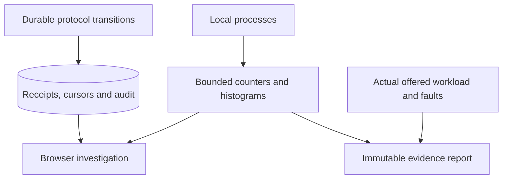

# Observability and outcome accounting

Every record carries applicable collection/generation/sequence, job/epoch/checkpoint or cluster/node/term/index plus correlation/request identity. Bounded structured logs redact secrets. Metrics explain behavior; durable records and client observations establish the acceptance oracle.

Show local role alongside term, leader hint, match/commit/applied indices, pending versus acknowledged commands, unknown outcomes, queue bounds and replication/disk latency. A leader label alone proves no safety property.

Workload: Three actual nodes and private stores; 50,000 keys <=1 KiB; >=200 successful operations/s for 60 seconds at 70% writes/CAS and 30% reads, p95 <=2 seconds; 1,000 logical clients with <=256 TCP connections.

Results include queueing time, offered/completed counts, generator limitations and resource samples. Checker/oracle failure and inconclusive outcomes are visible. Retain raw failed runs and never regenerate result templates over executed evidence.
