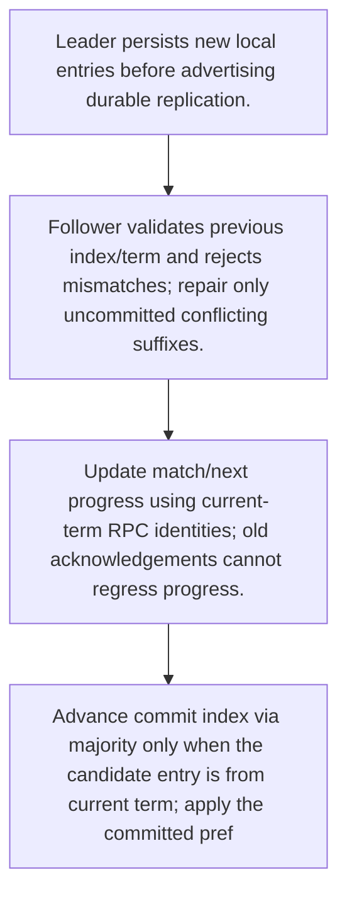

# Log matching conflict repair and majority commitment

An isolated old leader cannot acknowledge a new command from local append alone. On election append a current-term internal no-op to establish term commitment; client reads still enter the log. A committed prefix cannot be truncated by repair or stale snapshot installation.

## Algorithm

1. Leader persists new local entries before advertising durable replication.
2. Follower validates previous index/term and rejects mismatches; repair only uncommitted conflicting suffixes.
3. Update match/next progress using current-term RPC identities; old acknowledgements cannot regress progress.
4. Advance commit index via majority only when the candidate entry is from current term; apply the committed prefix in order.

## Interface and ownership

The service accepts bounded typed data plus logical target/request identity and the relevant epoch, term, pin or expected revision. It returns a durable result, explicit conflict or uncertainty. See [API](../contracts/api.md), [data model](../contracts/data-model.md) and [transactions](transactions.md). Network/worker acknowledgements mean only the boundary explicitly defined by the protocol.

## Required behavior

## Replication and commitment

Append locally and durably before claiming durable replication. Followers check the previous index and term, reject mismatches, and repair only uncommitted conflicting suffixes. A committed prefix must never be overwritten.

Track per-follower progress with term-aware responses. A leader advances commitment using a majority and the Raft restriction on directly committing entries from its current term. Earlier entries become committed through the resulting committed prefix.

Apply committed entries strictly in index order. An API success requires the relevant entry to be committed and its state-machine result to be durably applied. A successful leader response based only on its own append is an acceptance failure.

## Recovery and verification

Before-commit failure exposes no accepted local change. After-commit response loss is resolved through stable logical identity or persisted operation status. Stale epochs/terms/fences cannot mutate newer progress. The independent oracle must not call the production algorithm it evaluates. Exercise actual stop hooks and inspect committed records through the [harness](../testing/harness-and-fixtures.md); all runtime verdicts remain NOT RUN.
