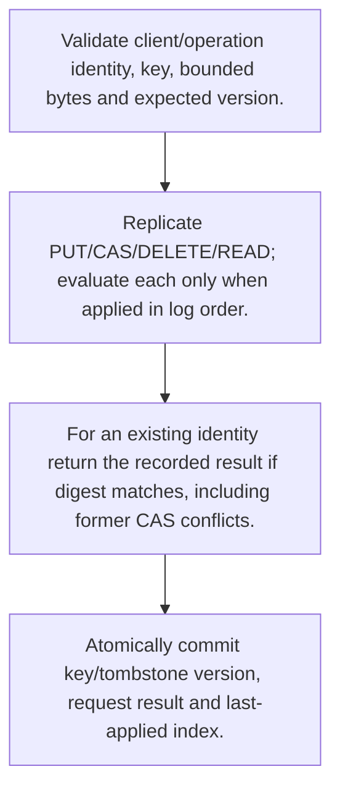

# Single-key semantics logged reads and deduplication

Absent version is zero; every successful mutation increments it, including recreate after tombstone. Failed CAS changes no key version but records a durable result. Changed identity content returns REQUEST_ID_CONFLICT without a second state-machine effect. A new READ is logged; an identical old READ retry returns its former result, not a fresh read.

## Algorithm

1. Validate client/operation identity, key, bounded bytes and expected version.
2. Replicate PUT/CAS/DELETE/READ; evaluate each only when applied in log order.
3. For an existing identity return the recorded result if digest matches, including former CAS conflicts.
4. Atomically commit key/tombstone version, request result and last-applied index.

## Interface and ownership

The service accepts bounded typed data plus logical target/request identity and the relevant epoch, term, pin or expected revision. It returns a durable result, explicit conflict or uncertainty. See [API](../contracts/api.md), [data model](../contracts/data-model.md) and [transactions](transactions.md). Network/worker acknowledgements mean only the boundary explicitly defined by the protocol.

## Required behavior

## State model

| Entity | Minimum fields |
| --- | --- |
| Hard state | cluster ID, node ID, current term, voted-for identity |
| Log entry | index, term, command type, request identity, payload digest, payload |
| Key state | key, value or tombstone, monotonically increasing version |
| Applied state | last applied index, application state, request-result records |
| Request result | client ID, operation ID, canonical payload digest, response, applied index |
| Snapshot | included index and term, state, deduplication records, format version, checksum |
| History record | invocation/response order, operation ID, node, result, timing, fault markers |

Each key begins absent at version zero. Successful PUT, CAS, and DELETE advance its version by one. A tombstone retains the version; delete and recreate must not create an ABA version reset. A failed CAS preserves state and version. Keys and operation IDs are bounded, nonempty strings. Values are opaque bounded bytes, represented safely in JSON.

## State machine contract

- `PUT(key, value)` assigns a value and returns the new version.
- `CAS(key, expected_version, value)` succeeds only when the current version equals the supplied version. Return the actual version on conflict.
- `DELETE(key, expected_version)` follows the same version check and retains a tombstone.
- `READ(key)` returns presence, value, and version at its position in the replicated command sequence.

For the first release, reads are replicated state-machine commands. Their response is evaluated when that command is applied in log order. This favors an understandable correctness boundary over an optimized read path.

Every logical command carries a unique `(client_id, operation_id)`. Repeating an identical command returns the recorded result, including a recorded CAS conflict. Reusing the identity with different content returns `REQUEST_ID_CONFLICT`. Deduplication records remain durable for the full first-release dataset; silent expiry is prohibited.

## Ambiguous outcomes and retries

A timeout or lost connection means the result may be unknown. It must not be represented as proof that no mutation happened. Clients retry with the same request identity. Responses distinguish success, version conflict, request identity conflict, not-leader, temporary unavailability, overload, and outcome-unknown.

Followers may return leader hints. They must not answer linearizable reads from their local state. An isolated old leader cannot complete newly submitted commands without a majority. It may still return a previously committed and durably recorded result for a retry, provided the response identifies that prior operation.

## Recovery and verification

Before-commit failure exposes no accepted local change. After-commit response loss is resolved through stable logical identity or persisted operation status. Stale epochs/terms/fences cannot mutate newer progress. The independent oracle must not call the production algorithm it evaluates. Exercise actual stop hooks and inspect committed records through the [harness](../testing/harness-and-fixtures.md); all runtime verdicts remain NOT RUN.
