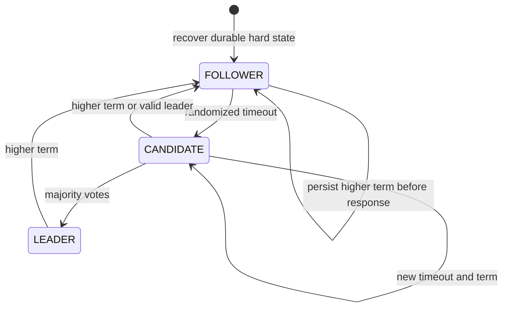

# State machines and transition guards

The diagram shows the primary protocol. Expected state, identity and current epoch/term/fence are checked at every accepting transition. Additional failure/cancellation rules are in [software requirements](../requirements/software.md). UI labels cannot set readiness or commitment.

Role is local volatile state informed by durable term/vote/log. Two perceived leaders in different terms do not permit conflicting committed entries. Higher-term transitions persist before dependent replies.

Timeouts are explicit outcomes. A retry of an existing committed operation returns its old result; it is not a new state transition. A controller/harness does not invent successful outcomes to advance a diagram.
