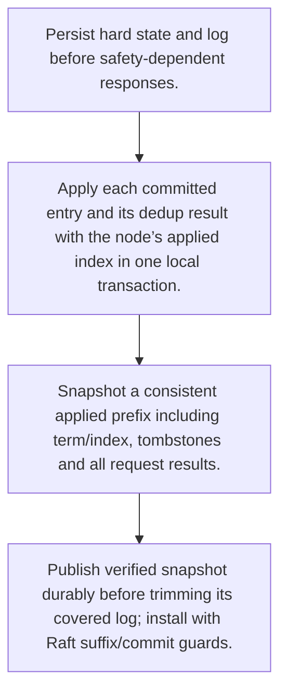

# Node durability atomic application and snapshots

The reference uses each node’s private SQLite transactions for hard state/log/apply, and immutable snapshot BLOBs. This supplies local persistence only; Raft remains from-scratch application logic. Corrupt/incompatible state stops that node, never silently initializes an empty cluster.

## Algorithm

1. Persist hard state and log before safety-dependent responses.
2. Apply each committed entry and its dedup result with the node’s applied index in one local transaction.
3. Snapshot a consistent applied prefix including term/index, tombstones and all request results.
4. Publish verified snapshot durably before trimming its covered log; install with Raft suffix/commit guards.

## Interface and ownership

The service accepts bounded typed data plus logical target/request identity and the relevant epoch, term, pin or expected revision. It returns a durable result, explicit conflict or uncertainty. See [API](../contracts/api.md), [data model](../contracts/data-model.md) and [transactions](transactions.md). Network/worker acknowledgements mean only the boundary explicitly defined by the protocol.

## Required behavior

## Durable application and snapshots

State changes, deduplication result, and applied index must advance atomically within each node's storage. Recovery must never apply a mutation twice because the process died between updating a value and saving its applied index.

Create snapshots only from a consistent applied prefix. Persist the snapshot and its metadata before discarding log entries it replaces. Snapshot publication must survive interruption without selecting a partially written artifact. Checksum or format errors stop that node with a clear recovery error.

Snapshot installation must preserve the included term/index, application state, tombstones, and request results. Apply the Raft snapshot/log suffix rules; do not discard valid newer committed state. A follower restored from a snapshot must catch up to the leader and reach the same state digest.

No filesystem operation should be called durable unless its flush/transaction settings are documented. Kill-process tests do not prove power-loss behavior. Corrupted state must not silently initialize a fresh cluster.

## Recovery and verification

Before-commit failure exposes no accepted local change. After-commit response loss is resolved through stable logical identity or persisted operation status. Stale epochs/terms/fences cannot mutate newer progress. The independent oracle must not call the production algorithm it evaluates. Exercise actual stop hooks and inspect committed records through the [harness](../testing/harness-and-fixtures.md); all runtime verdicts remain NOT RUN.
