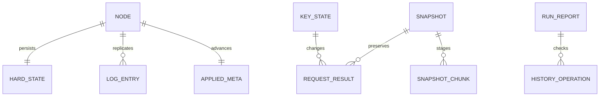

# Storage model and format evolution

The [reference DDL](../../schemas/reference-schema.sql) supplies principal keys, checks and indexes. The [data contract](../contracts/data-model.md) defines the complete entities. Runtime migrations must add checksums, immutable-field triggers and all domain invariants.

Each node stores its own hard state, log, applied index, key/tombstone state and request results. Snapshot trimming/install preserves the included index/term and valid retained suffix under Raft rules.

Format version, operator/index definition digest and source/cluster identity are mandatory recovery guards. A new executable cannot reinterpret old artifacts under changed semantics. Retention/cleanup runs in bounded resumable chunks and preserves required replay/dedup history. Live data stays on supported local disk outside OneDrive/network shares.
