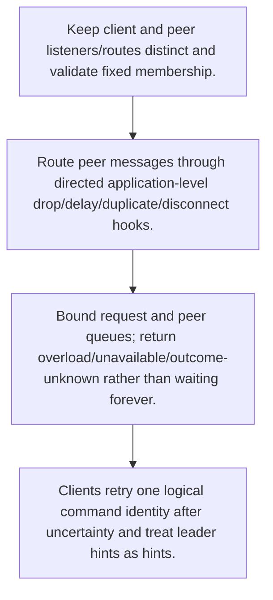
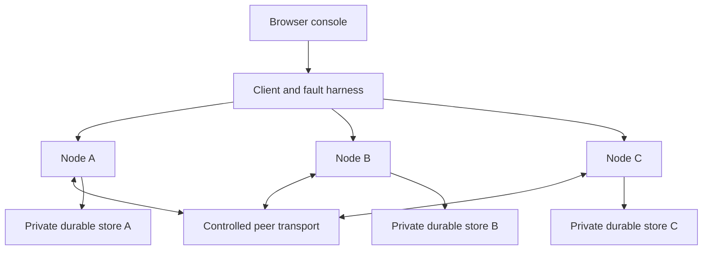

# Controlled peer transport admission and client uncertainty

The harness cannot choose the leader or commit value. No firewall/system network changes are needed. In-flight logical duplicates coalesce where useful, but safety comes from replicated deduplication. A not-leader or timeout is not proof an earlier command had no effect.

## Algorithm

1. Keep client and peer listeners/routes distinct and validate fixed membership.
2. Route peer messages through directed application-level drop/delay/duplicate/disconnect hooks.
3. Bound request and peer queues; return overload/unavailable/outcome-unknown rather than waiting forever.
4. Clients retry one logical command identity after uncertainty and treat leader hints as hints.

## Interface and ownership

The service accepts bounded typed data plus logical target/request identity and the relevant epoch, term, pin or expected revision. It returns a durable result, explicit conflict or uncertainty. See [API](../contracts/api.md), [data model](../contracts/data-model.md) and [transactions](transactions.md). Network/worker acknowledgements mean only the boundary explicitly defined by the protocol.

## Required behavior

## Architecture

The peer transport must support directed drop, delay, duplication, and disconnection without changing machine-wide networking. The harness controls only processes and files it created. Client traffic and peer traffic use separate listeners or distinguishable routes.

The UI may stop while a benchmark runs without affecting consensus. The harness is not a hidden central authority that selects leaders or decides committed values.

## Ambiguous outcomes and retries

A timeout or lost connection means the result may be unknown. It must not be represented as proof that no mutation happened. Clients retry with the same request identity. Responses distinguish success, version conflict, request identity conflict, not-leader, temporary unavailability, overload, and outcome-unknown.

Followers may return leader hints. They must not answer linearizable reads from their local state. An isolated old leader cannot complete newly submitted commands without a majority. It may still return a previously committed and durably recorded result for a retry, provided the response identifies that prior operation.

## API surface

| Route | Purpose |
| --- | --- |
| `POST /v1/commands` | Submit PUT, CAS, DELETE, or READ with request identity |
| `GET /v1/node` | Role, term, leader hint, commit/applied indices, limits |
| `GET /v1/log?after=...&limit=...` | Bounded metadata inspection; no unbounded dump |
| `GET /v1/snapshots` | Snapshot status and checksums |
| `GET /v1/metrics` | Counters and latency summaries |
| `POST /lab/faults` | Harness-only directed peer faults |
| `POST /lab/scenarios` | Run a named synthetic scenario |
| `GET /lab/reports/{id}` | Immutable scenario evidence |

Administrative routes bind to loopback and are clearly marked as lab controls. The harness may launch or terminate only tracked node processes. Request bodies, queues, peer messages, inspection ranges, and report sizes require explicit limits. Invalid messages produce errors without changing durable state.

## Recovery and verification

Before-commit failure exposes no accepted local change. After-commit response loss is resolved through stable logical identity or persisted operation status. Stale epochs/terms/fences cannot mutate newer progress. The independent oracle must not call the production algorithm it evaluates. Exercise actual stop hooks and inspect committed records through the [harness](../testing/harness-and-fixtures.md); all runtime verdicts remain NOT RUN.
