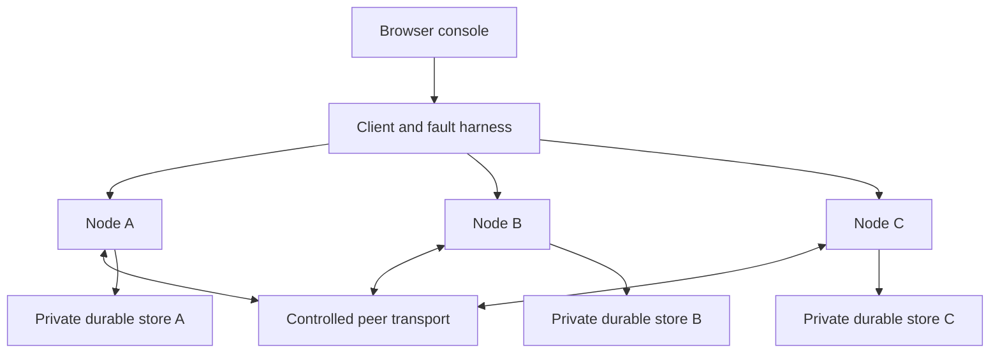

# QuorumSpindle — Replicated State and Consensus Engine

Version: 1.0 · Date: 25 November 2026 · Status: proposed requirements; implementation and acceptance tests have not been run.

## 1. Project in one paragraph

Build a small, real consensus system that keeps three independently running server processes in agreement while clients race to change shared state. The engine must continue through a leader crash, refuse unsafe writes during a network partition, recover its durable history, and expose enough evidence to explain every successful operation. A key/value and compare-and-set API makes the agreement observable. The main product is the replication and recovery engine; a local browser console helps investigate it.

This is intended for engineers who want a checkable implementation of the mechanisms behind reliable coordination services. The difficult part is deciding when an operation is safe to acknowledge, especially when messages and processes fail at inconvenient moments.

## 2. Ownership and submission status

This is an AI-assisted reference concept and planning document. It does not establish that the participant independently originated the idea, owns any future implementation, or has received program approval. The supplied program rules require the project to come from the participant. Before submitting, the participant must choose work they actually want to own, resolve that eligibility point with their project contact, and write their own submission. Do not present this document as an unaided personal statement.

No program development session should start before approval. No employer code, production systems, real accounts, or private data are required.

## 3. Required outcome

Deliver three local server processes, each with its own durable directory, a client and fault-test harness, an independent bounded-history checker, a benchmark runner, and a basic browser UI. Implement the Raft election, replication, commitment, and snapshot logic. A local transactional database or file library may provide storage primitives. Using an existing consensus service or consensus library as the engine does not meet the core goal.

The release is complete only when the correctness suite passes, fault histories are reproducible, and the measured workload meets the declared local pass bars. A running dashboard alone is insufficient.

## 4. Scope and boundaries

Required: fixed three-node membership; leader election; replicated commands; durable votes and log entries; linearizable reads; request deduplication; conflict repair; snapshots; restart; process and message fault injection; browser inspection; automated evidence.

Deferred: dynamic membership, cross-region deployment, Byzantine faults, arbitrary transactions spanning keys, public authentication, production TLS administration, clock-lease reads, and operating a real customer service. The API is a single-key state machine, not a general database.

All nodes run on one machine. This tests process failures and controlled communication failures. It does not demonstrate survival of independent machine, disk, power, or datacenter failures.

## 5. Local scale and pass bars

| Workload | Required target |
| --- | --- |
| Cluster | Three actual server processes; majority is two |
| Stored state | 50,000 synthetic keys, with values up to 1 KiB |
| Healthy benchmark | At least 200 completed successful operations/second for 60 measured seconds after warm-up; 70% writes/CAS and 30% reads; p95 latency at most 2 seconds |
| Client population | 1,000 logical client tasks; at most 256 simultaneous client TCP connections; client queuing time included in end-to-end latency |
| CAS race | 1,000 distinct contenders against the same expected version, repeated for 100 rounds; exactly one successful mutation each round |
| Recovery | After a leader is killed, a stable connected majority resumes successful commands within 5 seconds in 20 consecutive trials |
| Fault campaign | At least 100 seeded schedules, including partitions, delayed replies, crashes, and snapshot restoration |
| Soak | 30 minutes at 100 offered operations/second, with bounded request admission and explicit overload responses |

These are proposed local acceptance thresholds, not observed results or production capacity claims. Record CPU, memory, filesystem, runtime, storage durability settings, and commit hash. If the supplied desktop cannot sustain a threshold, report the measured result and revise the scope openly before approval or acceptance; do not replace measurement with extrapolation.

## 6. Architecture

The peer transport must support directed drop, delay, duplication, and disconnection without changing machine-wide networking. The harness controls only processes and files it created. Client traffic and peer traffic use separate listeners or distinguishable routes.

The UI may stop while a benchmark runs without affecting consensus. The harness is not a hidden central authority that selects leaders or decides committed values.

## 7. State model

| Entity | Minimum fields |
| --- | --- |
| Hard state | cluster ID, node ID, current term, voted-for identity |
| Log entry | index, term, command type, request identity, payload digest, payload |
| Key state | key, value or tombstone, monotonically increasing version |
| Applied state | last applied index, application state, request-result records |
| Request result | client ID, operation ID, canonical payload digest, response, applied index |
| Snapshot | included index and term, state, deduplication records, format version, checksum |
| History record | invocation/response order, operation ID, node, result, timing, fault markers |

Each key begins absent at version zero. Successful PUT, CAS, and DELETE advance its version by one. A tombstone retains the version; delete and recreate must not create an ABA version reset. A failed CAS preserves state and version. Keys and operation IDs are bounded, nonempty strings. Values are opaque bounded bytes, represented safely in JSON.

## 8. State machine contract

- `PUT(key, value)` assigns a value and returns the new version.
- `CAS(key, expected_version, value)` succeeds only when the current version equals the supplied version. Return the actual version on conflict.
- `DELETE(key, expected_version)` follows the same version check and retains a tombstone.
- `READ(key)` returns presence, value, and version at its position in the replicated command sequence.

For the first release, reads are replicated state-machine commands. Their response is evaluated when that command is applied in log order. This favors an understandable correctness boundary over an optimized read path.

Every logical command carries a unique `(client_id, operation_id)`. Repeating an identical command returns the recorded result, including a recorded CAS conflict. Reusing the identity with different content returns `REQUEST_ID_CONFLICT`. Deduplication records remain durable for the full first-release dataset; silent expiry is prohibited.

## 9. Election requirements

Implement the Raft rules against a reviewed transition table. A server persists its new term and vote before granting a vote or sending messages that depend on that durable state. A node grants at most one vote per term. A candidate's log must satisfy the up-to-date rule.

Use randomized election timeouts and monotonic local elapsed time. Expose timeout bounds in configuration and seed randomness in deterministic tests. Wall-clock changes must not determine commitment safety.

Higher-term messages make a node update its term and step down as required. Delayed responses from an earlier election or replication attempt must not overwrite newer state. Two nodes may temporarily believe they are leaders in different terms; the required guarantee is that conflicting commands cannot both become committed at the same log position.

## 10. Replication and commitment

Append locally and durably before claiming durable replication. Followers check the previous index and term, reject mismatches, and repair only uncommitted conflicting suffixes. A committed prefix must never be overwritten.

Track per-follower progress with term-aware responses. A leader advances commitment using a majority and the Raft restriction on directly committing entries from its current term. Earlier entries become committed through the resulting committed prefix.

Apply committed entries strictly in index order. An API success requires the relevant entry to be committed and its state-machine result to be durably applied. A successful leader response based only on its own append is an acceptance failure.

## 11. Ambiguous outcomes and retries

A timeout or lost connection means the result may be unknown. It must not be represented as proof that no mutation happened. Clients retry with the same request identity. Responses distinguish success, version conflict, request identity conflict, not-leader, temporary unavailability, overload, and outcome-unknown.

Followers may return leader hints. They must not answer linearizable reads from their local state. An isolated old leader cannot complete newly submitted commands without a majority. It may still return a previously committed and durably recorded result for a retry, provided the response identifies that prior operation.

## 12. Durable application and snapshots

State changes, deduplication result, and applied index must advance atomically within each node's storage. Recovery must never apply a mutation twice because the process died between updating a value and saving its applied index.

Create snapshots only from a consistent applied prefix. Persist the snapshot and its metadata before discarding log entries it replaces. Snapshot publication must survive interruption without selecting a partially written artifact. Checksum or format errors stop that node with a clear recovery error.

Snapshot installation must preserve the included term/index, application state, tombstones, and request results. Apply the Raft snapshot/log suffix rules; do not discard valid newer committed state. A follower restored from a snapshot must catch up to the leader and reach the same state digest.

No filesystem operation should be called durable unless its flush/transaction settings are documented. Kill-process tests do not prove power-loss behavior. Corrupted state must not silently initialize a fresh cluster.

## 13. API surface

| Route | Purpose |
| --- | --- |
| `POST /v1/commands` | Submit PUT, CAS, DELETE, or READ with request identity |
| `GET /v1/node` | Role, term, leader hint, commit/applied indices, limits |
| `GET /v1/log?after=...&limit=...` | Bounded metadata inspection; no unbounded dump |
| `GET /v1/snapshots` | Snapshot status and checksums |
| `GET /v1/metrics` | Counters and latency summaries |
| `POST /lab/faults` | Harness-only directed peer faults |
| `POST /lab/scenarios` | Run a named synthetic scenario |
| `GET /lab/reports/{id}` | Immutable scenario evidence |

Administrative routes bind to loopback and are clearly marked as lab controls. The harness may launch or terminate only tracked node processes. Request bodies, queues, peer messages, inspection ranges, and report sizes require explicit limits. Invalid messages produce errors without changing durable state.

## 14. Basic browser UI

Provide local HTML, CSS, and JavaScript, with optional locally compiled TypeScript. No CDN, external fonts, analytics, or online login.

Required screens: cluster overview; node/log inspection; key read/CAS playground; directed partition controls; scenario runner; and report viewer. Display terms and indices beside role labels so users can understand delayed information. Separate committed entries from pending entries. Show an unknown client outcome as unknown.

All destructive lab actions identify affected test nodes. Controls need keyboard access, visible error states, disabled/busy behavior, and confirmation for deleting a test dataset. Polling must be bounded and must not become benchmark traffic unless explicitly selected.

## 15. Fault scenarios

Inject interruptions before and after local append, follower persistence, majority acknowledgement, commitment, state application, response transmission, snapshot publication, and snapshot installation. Provide repeatable hooks rather than relying only on arbitrary sleeps.

Partition one node from the other two, isolate the leader, create an asymmetric link failure, delay old-term responses until after re-election, and reconnect a follower with a conflicting suffix. Run a full-cluster process restart from existing directories. In every scenario, track acknowledged operations separately from ambiguous operations.

Fault schedules are confined to the application transport and owned child processes. Do not require root, firewall changes, or access to another workspace.

## 16. Independent correctness checks

Maintain a simple reference model for the key state and CAS semantics. Build a bounded-history linearizability checker that searches legal sequential orderings while respecting invocation/response precedence. Cap each exhaustive case at 200 operations and declare checker timeouts inconclusive, never passed.

Include incomplete and indeterminate operations as optional effects according to the checker model. Validate the checker using known legal and illegal histories, including a stale read and two successful CAS operations against one version.

For large workloads, validate committed-log/state digests, request uniqueness, and final state against a fold of the committed commands. Check sampled bounded histories separately. These checks complement one another; they do not establish that every large history has been exhaustively linearizability-checked.

## 17. Acceptance catalog

Every item initially has status **NOT RUN**.

| ID | Required evidence and pass condition |
| --- | --- |
| QS-01 | Three nodes elect a leader and accept commands without a coordinator deciding outcomes |
| QS-02 | Persisted vote survives restart; no second vote in the same term |
| QS-03 | A candidate with an outdated log cannot win against a current majority |
| QS-04 | Follower conflict repair preserves every committed entry |
| QS-05 | Delayed old-term messages cannot roll back current term or progress |
| QS-06 | 1,000-way CAS race has exactly one winner in each of 100 rounds; all other completed results are conflicts |
| QS-07 | Every race completes within 30 seconds per round on the declared baseline, without unknown outcomes |
| QS-08 | Duplicate command after lost response produces one mutation and the same result |
| QS-09 | Same identity with different content is rejected before any second effect |
| QS-10 | Delete/recreate retains monotonic versions and rejects stale CAS |
| QS-11 | Isolated minority cannot commit newly submitted commands during a 10-second partition |
| QS-12 | Connected majority progresses during that partition |
| QS-13 | Leader crash meets the five-second recovery bar in all 20 trials |
| QS-14 | Every acknowledged mutation survives full process restart |
| QS-15 | Crash at each apply hook cannot produce double application |
| QS-16 | Snapshot restore and catch-up reproduce state and request-result digests |
| QS-17 | Interrupted snapshot publication retains a usable prior state |
| QS-18 | Corrupt snapshot fails clearly; node does not silently reset |
| QS-19 | All bounded histories in 100 seeded fault schedules pass the checker |
| QS-20 | Checker rejects supplied illegal histories and reports timeouts as inconclusive |
| QS-21 | Healthy workload meets throughput and p95 targets with durability enabled |
| QS-22 | Soak has zero safety failures and bounded queues; terminal memory remains within a declared 2 GiB combined application budget |
| QS-23 | Oversized requests and full queues return explicit errors without process failure |
| QS-24 | Browser tests cover command, partition, recovery, and report flows offline |
| QS-25 | One local command reproduces fixtures, scenario metadata, histories, and checks |

## 18. Work split across sessions

1. Freeze semantics, invariants, failure model, and reference histories. Verify local runtime and storage availability.
2. Build the deterministic single-node state machine, request deduplication, and atomic application.
3. Implement durable election and a controllable peer transport; test vote persistence and term transitions.
4. Add replication, conflict repair, majority commitment, and ordered application.
5. Finish client retries and replicated reads; run CAS races and minority-partition cases.
6. Implement snapshots, installation, restart, and interruption hooks.
7. Build and challenge the history checker; run seeded fault campaigns and resolve counterexamples.
8. Add the browser console and end-to-end tests.
9. Measure load and recovery, tune bounded admission without weakening durability, and complete the soak.
10. Produce the reproducible evidence bundle and review every acceptance item.

Each session ends with a runnable checkpoint, tests actually executed, remaining failures, and the next concrete task. Session length follows the program's separate time rules; this plan does not assume everything fits one session.

## 19. Stack and desktop fit

Backend language remains open. Suitable supported runtimes include Java 21, Rust, Python 3.12, Node 22, C/C++, or Go using its standard library only. Choose one after a dependency availability check. Use independent local stores with documented synchronous durability; SQLite is an available option, subject to the chosen runtime's driver availability.

The interface is a web app opening in local Chrome. Tests may use Playwright if its locally installed runtime is usable. Build and runtime must function without internet, Docker, GPU, sound, cloud services, private accounts, or external nodes. Ship local fixtures and dependency instructions that work with the supplied mirror. Avoid relying on unavailable native packages or apt-get.

## 20. Deliverables and completion evidence

Deliver source, local setup/run commands, protocol transition notes, storage format/version notes, generated fixtures, test harness, checker, basic UI, acceptance matrix, benchmark report, and a failure-analysis document with at least three reproduced bugs and their fixes if such bugs are found. Do not invent bugs to fill that document.

Reports retain seed, commit, configuration, machine details, command line, counts, percentiles, failures, and immutable history paths. Separate expected request conflicts from transport errors and safety violations. Keep raw evidence for failed runs.

## 21. Risks and decisions to resolve

The highest risks are incomplete Raft rules, unsafe persistence ordering, mishandled unknown outcomes, and a checker that incorrectly certifies a history. Resolve these before UI polish. Select the storage transaction boundary, snapshot format, message framing, timeout ranges, maximum request count, and benchmark baseline explicitly. Fixed membership and logged reads keep the first release bounded without removing its core systems challenge.

## 22. Primary technical reference

[Raft extended paper, Ongaro and Ousterhout](https://raft.github.io/raft.pdf) — normative reference for the consensus protocol and snapshot rules. The project requirements, API, workload, UI, and acceptance catalog above are proposed design choices, not claims about a completed implementation or borrowed performance results.
