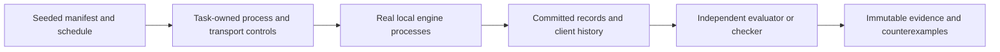

# Independent oracles fault harness and fixtures

A 1,000-contender CAS race repeats 100 times with exactly one winner and completed conflicts within 30 seconds/round. Twenty leader-kill trials must recover a stable majority within five seconds. One hundred seeded fault schedules and a thirty-minute soak retain actual failures and unknown outcomes.

Tests own isolated paths, loopback ports and tracked process IDs. Deterministic barriers acknowledge the exact boundary before append, snapshot, cursor, pointer/manifest/commit, apply or response. A scenario that never reaches its intended hook does not pass. No firewall changes, root, external machines or private data are required.

Keep production and oracle algorithms separate. Hand-calculated legal/illegal fixtures establish the oracle, then seeded end-to-end schedules exercise it. The [acceptance plan](acceptance-plan.md) retains exact repetition/pass bars; a generic twenty-run rule must not replace the source’s specific campaigns.

Record invocation/response precedence and uncertain operations; bound exhaustive checks at 200 operations and mark timeout INCONCLUSIVE. A large committed-state digest is a complementary check, not an exhaustive history proof.

Reports retain seed, commit, configuration, environment/durability settings, command, actual fault hooks, IDs/cursors, counts/percentiles, failures, checksum references and immutable artifact locations. Fixture hashes are calculated during implementation, never invented in the planning repository.
